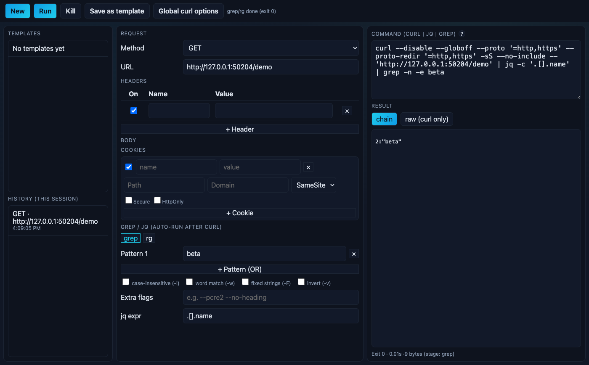

# curl-builder

A personal desktop tool for learning curl flags and templating common commands.
Explore request options, inspect the resulting CLI pipeline, and reuse requests
with placeholders and saved templates. It runs your installed curl, jq, and grep/rg.



Built with Electron, React, and TypeScript. The main process runs argument arrays
without a shell; a preload bridge connects it to the renderer.

## Explore the project

- [Product scope](PRODUCT.md): primary workflow, boundaries, priorities, and validation gaps.
- [Architecture](docs/ARCHITECTURE.md): execution/data flow and technical tradeoffs.
- [Contributing](CONTRIBUTING.md): local checks and review expectations.
- [Agent instructions](AGENTS.md): coding-agent context, commands, and invariants.
- [Security and privacy](docs/SECURITY.md): supported CLI options, trust/data boundaries, and limits.
- [Maintenance](docs/MAINTENANCE.md): shared checks, optional hooks, dependencies, and versioning.
- [Changelog](CHANGELOG.md): actual pending changes and release notes.

Local typecheck, 70 tests, build, security/desktop checks passed on
macOS/Node 24.14.1 on 2026-10-14, including clean development startup.
The desktop check covers recognized flag descriptions, template save/disk reload,
variable prompting, replay after a full app-process restart, and recovery from
unreadable synthetic config/template files. GitHub CI is configured; its remote result has not been verified.
This is a local prototype; see the limits below.

## Prerequisites

- Node.js 22.12+ on the 22.x line, or 24+ (verified with Node 24.14.1)
- npm and curl
- jq for JSON filtering; grep or ripgrep (`rg`) for text filtering

The configured binary path is used when it matches the selected grep engine.
Switching engines falls back to `grep` or `rg` on PATH.

## Install and check

```sh
npm ci
npm run check
```

The test suite uses synthetic requests, mocked renderer interactions, isolated
storage, and a temporary HTTP server bound to `127.0.0.1`. It requires curl, jq,
and grep on PATH; it does not call remote APIs.

## Launch

```sh
npm start
```

Build first. Alternatively, `./run.sh` builds and launches in one step.
For development:

```sh
npm run dev
```

This watches the main/preload bundles and serves the renderer on
`http://127.0.0.1:5173`. Electron waits for both bundles and the server before
opening. Port 5173 must be available.

## Request workflow

1. Set the method, URL, headers, and optional body. Body controls appear for
   POST, PUT, and PATCH.
2. Add `{{NAME}}` placeholders to prompt for values at execution time. Global
   curl presets can insert reusable argument snippets into the request.
3. Select a recognized flag in the command to inspect its description. Save a
   common request with **Save as template**, enter a name, and save. Click a saved
   template (or focus it and press Enter) to supply variables and run it. Templates
   retain request options, cookies, and filters; presets reuse smaller argument snippets.
4. Optionally enter a jq expression and one or more grep patterns. Filtering runs
   automatically after curl. The command area parses edits back into the builder
   on a best-effort basis.
5. Click **Run** (or Ctrl/Cmd+Enter). **chain** shows the final stage; **raw** shows
   the captured response from that same execution. Switching tabs never sends
   another request. Click **Run** again to deliberately repeat it.

Default curl options are `-sS -i`, with redirects and request timeouts off unless selected.
The visible command also suppresses implicit curl config, disables URL globbing
and limits requests/redirects to HTTP(S). Body/form controls send literal text;
file uploads, output files and additional transfers are outside scope.
Response headers are captured separately from the body, so jq receives JSON even
with headers enabled. A copyable jq pipeline uses `--no-include`; the raw view can
still show the captured headers. Internally, curl writes headers to a temporary
file that is removed after execution.

The cookie helper sends enabled `name=value` pairs only. Its optional attributes
are retained as editing metadata; they are not sent in the Cookie header. A manually
entered Cookie header is preserved when the helper has no enabled pairs.

The Kill button stops active curl. Filters default to 30 seconds with a 60-second
ceiling; positive configured timeouts can make that shorter. Ctrl/Cmd +, -, and 0 control zoom.

## Local data

Configuration, explicitly saved templates, and diagnostic `run.log` live in
Electron's `userData` directory, outside the checkout. For isolated local runs,
set `CURL_BUILDER_DATA_DIR` to an absolute directory:

```sh
CURL_BUILDER_DATA_DIR=/absolute/path/to/demo-data npm start
```

[config.example.json](config.example.json) contains only defaults and a synthetic
routing example. To use it, copy it to `config.json` in the chosen data directory
before launch. Existing repo-root config, templates, history, and logs are left
untouched and are not imported automatically. Review any old files yourself
before manually moving selected settings.

History is session-only. It keeps the original unresolved inputs, clears prompt
values, and disappears when the app closes. Diagnostic logs record stage outcomes,
byte counts, and enabled-input counts, without URLs, commands, header/cookie values,
filter contents, or exception text. Responses remain in memory, apart from the
short-lived header capture. Explicitly saved templates and configuration can still
contain literal values you put there; use placeholders for credentials.

## Errors and recovery

Run, Save and global-setting changes stay disabled while saved settings/templates
load. If a file cannot be read, the window shows **Retry setup** and leaves saved
files intact. Check the chosen data directory, permissions and JSON format; back
up the affected file before repairing it, then retry. The app does not reset or
replace an unreadable collection with an empty one. A missing preload bridge
requires rebuilding and restarting the desktop app.

Curl/jq failures show error output and stop downstream filtering. Fix the binary
path, request or expression and deliberately rerun. Grep exit 1 is shown as no
matches. Error details are visible in the window; diagnostic run.log retains only
metadata. These checks use synthetic files and do not inspect personal data.

## Implementation and limits

`src/shared` handles argument construction and curl parsing; `src/main` owns
subprocesses and local storage; `src/renderer/App.tsx` owns the request editor and
pipeline orchestration. Headers are captured independently rather than guessed
from response text, and the raw tab reuses the same response so viewing it cannot
repeat a POST. Session history trades restart persistence for avoiding automatic
storage of resolved request values.

This is a local prototype with no packaged installer or cross-platform desktop
validation. Sandboxing, document/sender validation, runtime input checks, navigation
and CSP rules restrict the renderer. CLI options are intentionally scoped to one
HTTP(S) request and stdin filtering. Captures and saved data have size limits;
subprocesses do not inherit credential/proxy environment variables.

Read [security and privacy](docs/SECURITY.md) before using sensitive requests.
Installed binaries, the development server and local filesystem are trusted;
main/subprocess execution retains user privileges. Parsing is best effort and the
app is not a full shell, download/file-upload client or encrypted credential vault.
The desktop check verifies the main task, restart/recovery and selected hostile
IPC/window/input cases; it is not an exhaustive security audit.

## Desktop smoke and screenshot

After building, run:

```sh
npm run test:desktop
```

This opens the app, runs synthetic loopback requests through the real preload/IPC
bridge, checks filtered/raw output and local-data behavior, then saves a template,
reloads the renderer, then exits and launches fresh Electron processes to verify
restart/replay and recovery from unreadable config/templates. It checks a recognized
flag description, rejects unsafe IPC/window actions, and updates `docs/synthetic-workflow.png`. The Node controller
removes inherited Electron Node-only/dev-server overrides and uses a temporary data
directory and removes that directory afterward. It does not use your saved settings
or send a remote request. Desktop validation so far is on macOS only.

## Manual scenarios

```sh
npm run scenarios -- --file scenarios/sample.json
```

The scenario tool renders a checklist and supports `--type` and `--id` filters.
See [scenarios/sample.json](scenarios/sample.json) for the format.

## Development and contribution

This personal prototype was developed with AI-generated implementation, ongoing
product guidance, and manual testing by the project owner. The current cleanup,
documentation, and automated checks also use AI assistance. The repository is
intended to make the resulting behavior, decisions, and validation inspectable.

## License

This project uses the [ISC license](LICENSE). React runtime dependency notices
are reproduced in [third-party notices](THIRD_PARTY_NOTICES.md). Any future
packaged distribution must also preserve the licenses/notices of what it bundles.
