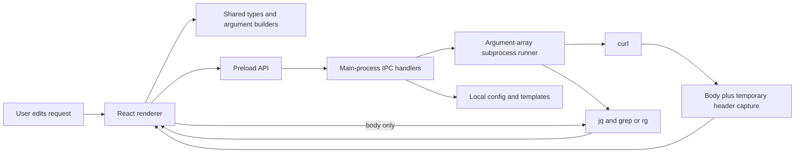

# Architecture and decisions

The application has three execution contexts plus shared request/argument code.

## Where to change things

| Responsibility | Entry points |
| --- | --- |
| Product/editor state and pipeline sequencing | [App.tsx](../src/renderer/App.tsx) |
| Window, startup, local-data initialization | [main.ts](../src/main/main.ts) |
| Renderer/main bridge | [preload.ts](../src/preload/preload.ts), [ipc.ts](../src/main/ipc.ts) |
| Process lifecycle, stdin, timeout | [runProcess.ts](../src/main/runProcess.ts), [processRegistry.ts](../src/main/processRegistry.ts) |
| Request parsing/construction | [curlParser.ts](../src/shared/curlParser.ts), [curlArgsBuilder.ts](../src/shared/curlArgsBuilder.ts) |
| Template substitution | [templateUtils.ts](../src/shared/templateUtils.ts) |
| Response/filter execution | [executeCurl.ts](../src/main/executeCurl.ts), [executeJq.ts](../src/main/executeJq.ts), [executeGrep.ts](../src/main/executeGrep.ts) |
| Local data and diagnostic file | [storage.ts](../src/main/storage.ts), [runLog.ts](../src/main/runLog.ts) |

## One execution

The renderer executes an explicit request snapshot, resolves supplied variables,
and builds cookie pairs, then invokes the
preload API. Main builds curl arguments and starts a subprocess with `shell: false`.
Headers go to an owned temporary file while body output is collected separately.
The header file is removed in `finally`. The renderer retains this response,
passes the body to jq when requested, then passes that stage's output to grep.
An empty jq result stays empty. Raw and chain views share the same curl execution.

The preview is an equivalent user-facing pipeline. Header capture uses additional
internal plumbing that is not included in the copyable preview. Arbitrary curl
options that redirect output or introduce multiple transfers are not verified by
this path. Capturing text also does not make this a streaming binary/download UI.

## Data and boundaries

Electron userData, or an absolute `CURL_BUILDER_DATA_DIR`, stores config,
explicitly saved templates, and metadata-only run.log. Session history retains
unresolved inputs in renderer memory. Old repo-root files are not imported.
Templates/config can contain literal values; no encryption/credential vault is
implemented. Temporary response headers may also contain sensitive values while
the request is running. A process crash can bypass normal cleanup.

Context isolation and disabled renderer Node integration are existing boundaries.
Sandboxing, exact active-window/top-frame validation, runtime contracts and
navigation/CSP policy now restrict the renderer. `runProcess` uses a minimal
environment and bounded text captures; filters have a time ceiling. Main and
installed binaries retain user privileges. See [security boundaries](SECURITY.md)
for option policies, data limits and remaining assumptions.

## Tradeoffs and maintainability

Using real CLI tools avoids reimplementing curl/jq semantics but requires installed
binaries and makes portability part of the contract. Capturing headers separately
avoids guessing where JSON begins, at the cost of short-lived filesystem state.
Session history avoids automatic persistence, at the cost of restart convenience.

The renderer remains a large component. Extract product state and execution
orchestration incrementally when changing those behaviors, retaining regression
coverage; a broad rewrite solely for appearance is not necessary.

These are observations and current decisions, not claims about undocumented
original design intent. See [product scope](../PRODUCT.md) for validation gaps and
[contribution guidance](../CONTRIBUTING.md) for the check sequence.

## Template reuse

Templates serialize unresolved request inputs, effective curl options, cookies,
and filter settings. Runtime IDs, preset UI IDs (already expanded into arguments),
and resolved variable values are omitted. Loading makes a fresh request; the
builder retains placeholders while execution substitutes the supplied values.
Passing that snapshot directly to execution prevents React's previous render
closure from sending the request that was active before template selection.
Older templates without optional settings continue to use defaults.

## Startup and recovery

Main keeps the window available when saved config cannot be read. The renderer
loads config and templates before persisting merged settings or enabling actions.
Read failures leave saved files intact and offer retry; config is reread on retry
through IPC. Rejected saved-file IPC errors use generic messages so Electron's
console error reporting does not include JSON parser snippets. Execution failures
stop subsequent stages; stderr/error information is shown to the user, while run.log
keeps metadata. Grep no-match is a normal outcome.

## Security implementation map

`rendererPolicy.ts` defines the bundled/exact-loopback document; `ipc.ts` checks
window/frame identity before dispatch. Shared `validation.ts` enforces payload and
saved-data contracts, and `cliPolicy.ts` scopes command capabilities. Curl's visible
defaults suppress implicit config and limit protocols/globbing; internal capture
adds header plumbing. Raw/form bodies use literal CLI options. Storage/logs use
private temporary files and rename; validation failure leaves saved data untouched.
No general schema, hook, release or security framework was introduced.
